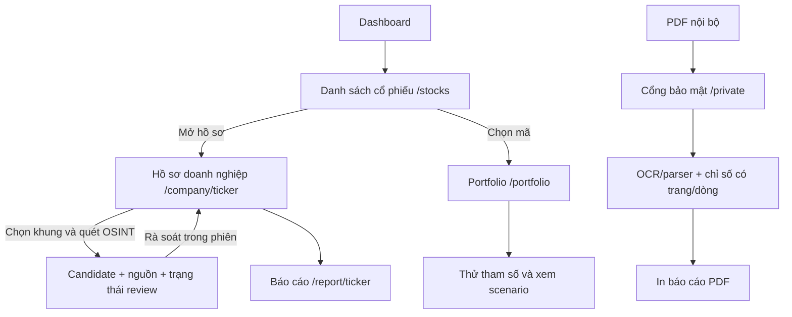

# Luồng người dùng QuantumRegTech

**Bản:** dùng để kiểm duyệt nội dung và tập demo
**Trạng thái:** phản ánh khả năng hiện có của repo; phần chưa triển khai được ghi riêng.
**Đặc tả sản phẩm chuẩn:** [Spec Kit feature spec](../specs/001-investor-due-diligence-demo/spec.md) · [Architecture plan](../specs/001-investor-due-diligence-demo/plan.md)

## 1. Mục tiêu và người dùng

Quản lý quỹ/chuyên viên đầu tư cần tra cứu doanh nghiệp F&B, xem các rủi ro có nguồn, thử cách phân bổ vốn và rà soát thêm tài liệu nội bộ. Người dùng phải phân biệt được dữ liệu workbook, dữ liệu live, tín hiệu báo chí, kết quả tính toán và kết quả cần reviewer xác nhận.

## 2. Sơ đồ luồng chính

Luồng PDF hiện là nhánh thẩm định riêng. Kết quả PDF **chưa được áp dụng** vào hồ sơ public hoặc Portfolio.

## 3. Luồng demo người dùng

### Bước 1 — Mở danh sách cổ phiếu

**Route:** `/stocks`
**Người dùng:** nhà đầu tư / quản lý quỹ.

1. Xem số mã có dữ liệu trong universe hiện hành.
2. Tìm mã theo ticker, tên, ngành hoặc sàn.
3. Chọn/bỏ chọn các mã analysis-ready trong universe 9 mã hiện có.
4. Bấm ticker để mở hồ sơ doanh nghiệp hoặc `Mở danh mục` để mang selection sang Portfolio.

**Kết quả nhìn thấy:** danh sách mã và các trường Ri, ESGi, Altman Z/zone, RFin total, số tín hiệu OSINT. Mỗi mã đi tới hồ sơ riêng để xem công thức, dữ liệu chi tiết và nguồn.

**Cần nói rõ khi demo:** workbook hiện có dữ liệu phân tích cho 9 mã. Mã mới đăng ký chỉ thành analysis-ready sau khi nhập dữ liệu có nguồn và kiểm tra.

### Bước 2 — Xem hồ sơ và rà soát OSINT

**Route:** `/company/MCM` (hoặc ticker người demo chọn).

1. Chỉ ra Altman Z/zone, ESGi, các ô đang thiếu, timeline OSINT và công thức `RFin base + POSINT = RFin total`.
2. Chọn khung 6/12/24/36/60 tháng rồi bấm `Quét sự kiện`.
3. Backend chạy 1 job Firecrawl Agent cho mã đó trong khoảng ngày đã chọn đến hôm nay. Sự kiện đã duyệt trong workbook hiện ở mục riêng; sự kiện mới cần reviewer chấp nhận.
4. Người dùng mở nguồn của từng sự kiện mới, bấm "Chấp nhận mức 1/2/3" hoặc "Bỏ". P_OSINT = mức cao nhất theo bảng Params (không cộng dồn); R_fin,total cập nhật trong phiên.
5. Chưa có audit log bền vững hoặc ghi vào hồ sơ chính thức. Thiếu key/FastAPI → chỉ hiện sự kiện đã duyệt trong workbook.

**Cách diễn giải MCM:** workbook giữ bài báo phản ánh nguy cơ môi trường năm 2022 ở mức 1 (`+0.05`), không phải mức 2 (`+0.10`), vì chưa có quyết định xử phạt được xác định. Đây là mức phân loại nội bộ, không phải kết luận pháp lý; xem [ghi chú dữ liệu](DATA.md).

### Bước 3 — Chọn mã và thử Portfolio

**Route:** `/portfolio`.

1. Quay về `/stocks`, chọn các ticker có dữ liệu rồi mở danh mục.
2. Điều chỉnh mức ưu tiên và tổng vốn.
3. So sánh tỷ trọng tham chiếu, lợi suất CAPM và lợi suất giá lịch sử.
4. Nếu chọn mã chưa có scenario hoặc tập mã làm giới hạn min/max bất khả thi, giao diện phải báo rõ.

**Cách diễn giải hiện tại:** tỷ trọng được phân bổ theo thứ hạng và mức ưu tiên. Bản hiện tại chưa chạy Markowitz/COBYLA/QUBO/QAOA và chưa tính covariance từ chuỗi giá hợp lệ. Không gọi tỷ trọng là nghiệm solver hoặc kết quả lượng tử.

### Bước 4 — Nạp hồ sơ PDF nội bộ

**Route:** `/private`.
**File gợi ý:** `tests/fixtures/bctc-mau-qrt-2024.pdf` (doanh nghiệp giả định); bản scan `tests/fixtures/bctc-mau-qrt-2024-scan.pdf` để minh họa OCR.

1. Thêm PDF, xác nhận quyền cung cấp và bấm xử lý.
2. Hệ thống đọc text hoặc OCR trong trình duyệt, sau đó parser tìm các chỉ tiêu BCTC hỗ trợ. Có thể bật AI Agent bằng checkbox opt-in riêng; chỉ text OCR/extracted được gửi, không gửi PDF gốc.
3. LangGraph `llm_extract → validate_evidence` map nhãn linh hoạt sang schema 9 trường. Chỉ lấy giá trị khi quote khớp trích xuất ở trang được nêu; parser rule values được giữ làm đối chiếu.
4. Đối chiếu giá trị với trang/quote gốc trong bảng extraction. Thiếu dữ liệu thì giữ `—`; không điền suy đoán.
5. Dùng nút in để lưu bản PDF của kết quả.

**Cách diễn giải hiện tại:** mặc định là OCR/parser xác định. Khi người dùng opt-in, text được gửi tới LLM provider đã cấu hình để trích xuất có bằng chứng; đây chưa phải RAG. Ứng dụng bỏ tham chiếu tới PDF gốc khỏi phiên sau xử lý, không tuyên bố xóa khỏi browser memory/log/cache/hạ tầng hoặc retention của nhà cung cấp. Kết quả không tự nhập vào hồ sơ public hoặc portfolio.

### Bước 5 — Xuất báo cáo doanh nghiệp

**Route:** `/report/VNM` (hoặc ticker từ hồ sơ).

1. Rà soát phần tổng quan, Z-score, ESG, OSINT, phương pháp, nguồn và giới hạn dữ liệu.
2. Dùng `In / Lưu PDF` của trình duyệt.

Báo cáo hiện là report theo dữ liệu công ty trong workbook. Nó chưa hợp nhất dữ liệu PDF nội bộ của bước 4.

## 4. Trạng thái và ý nghĩa dữ liệu

| Trạng thái | Ý nghĩa khi trình bày |
|---|---|
| Workbook event | Sự kiện đã có trong workbook và được duyệt; không phải kết quả vừa crawl |
| Live candidate / `Needs review` | Tìm được nguồn web; chưa xác nhận nội dung hoặc mức độ vi phạm |
| `Already in assessment` | Sự kiện đã nằm trong POSINT hiện tại; scan demo không được cộng lần nữa |
| `TODO` / `—` | Chưa có dữ liệu đầu vào đáng tin cậy |
| Calculated | Kết quả do công thức/logic xác định trong repo tính từ dữ liệu đầu vào |
| Private extraction | Trích từ PDF người dùng; cần đối chiếu nguồn trang/dòng |

## 5. Mở rộng danh sách mã

`/stocks` đọc danh sách từ company universe sinh bởi Excel. Thêm mã cho demo hiện tại cần cập nhật ticker và dữ liệu khớp ở các sheet liên quan (Companies, Financials, ZScore, Market, ESG, OSINT, Portfolio/Scenarios), sau đó chạy `npm run data`. Chỉ thêm mã vào Companies mà thiếu financial/ESG/market/scenario inputs thì **không** làm mã đó sẵn sàng cho mọi chức năng.

Hiện tại `/stocks` cho đăng ký mã mới kèm nguồn tham chiếu vào registry FastAPI/SQLite; mã trả về ở trạng thái `pending_data`, hiển thị trong danh sách chờ nhưng chưa có hồ sơ điểm số và không được đưa vào optimizer. Bước nhập và kiểm tra bộ dữ liệu tài chính vẫn phải được hoàn thành trước khi mã chuyển thành `analysis_ready`. Khi universe lớn, dùng search/filter và cursor pagination; không tải toàn bộ phân tích cho hàng nghìn mã cùng một lượt.

Với hồ sơ đủ dữ liệu, CAPM/return/Altman/RFin base được tái tính bằng financial engine khi sinh JSON. ESGi vẫn là số workbook đã cung cấp. Luồng OSINT live dùng Firecrawl và Jina Reader (dự phòng, có giới hạn); Gemini/Groq có thể đề xuất phân loại từ tiêu đề/trích đoạn. Câu trích dẫn không khớp phần văn bản được lấy về sẽ bị loại; reviewer quyết định trong phiên hiện tại.

## 6. Tiêu chí duyệt trước khi chốt kịch bản

- [ ] Tên và universe đang dùng được giới thiệu rõ là dữ liệu demo.
- [ ] Mã được chọn từ danh sách; không nói ứng dụng đang hỗ trợ 9 mã khi workbook hiện chỉ nạp đủ bốn hồ sơ.
- [ ] Không gọi bài báo MCM là quyết định xử phạt đã xác nhận.
- [ ] OSINT live có URL nguồn và trạng thái review; fallback được gắn nhãn demo.
- [ ] Không nói slider hiện tại chạy tối ưu mới hoặc QAOA.
- [ ] PDF mẫu được giới thiệu là doanh nghiệp giả định; phân biệt LLM extraction opt-in với RAG (chưa triển khai).
- [ ] Không tuyên bố Zero-Retention toàn hạ tầng hoặc PDF private đã cập nhật hồ sơ public.
- [ ] Mọi ô thiếu được giữ `—` và mọi biểu đồ thiếu chuỗi dữ liệu có empty state.
